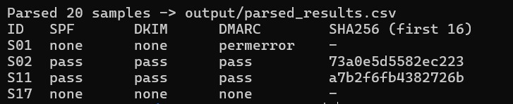
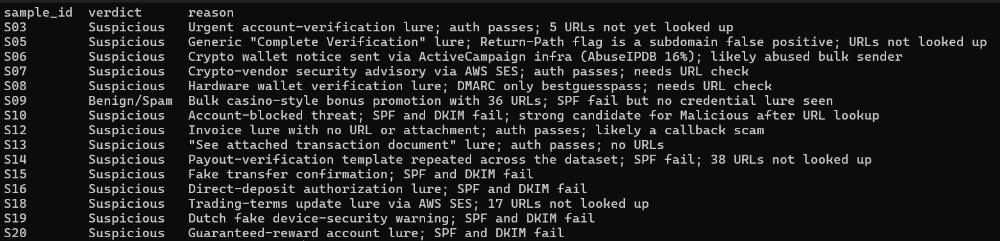
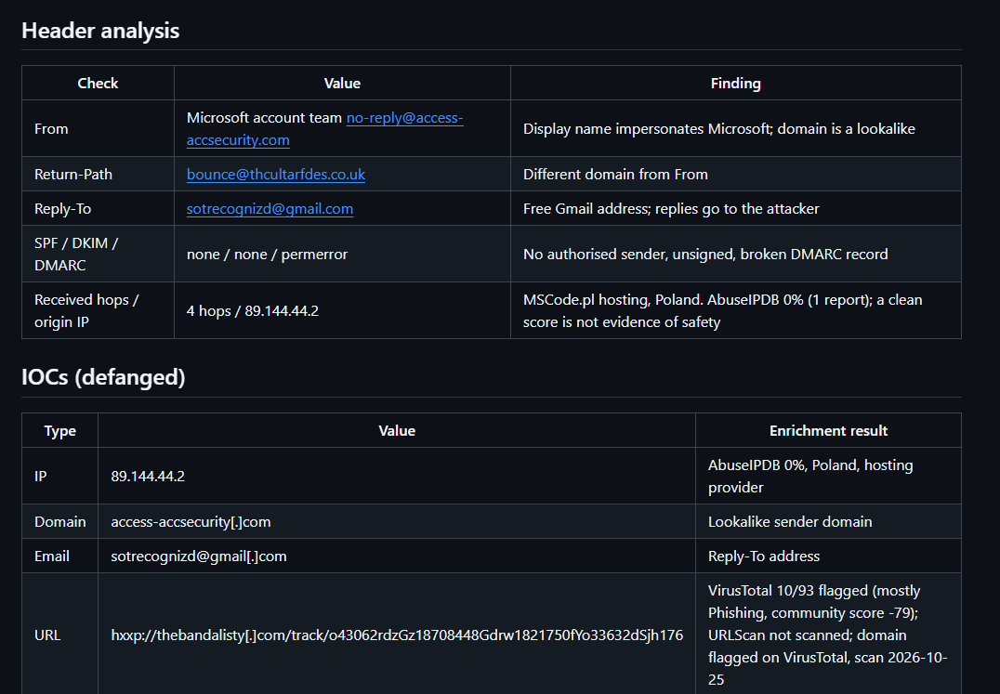
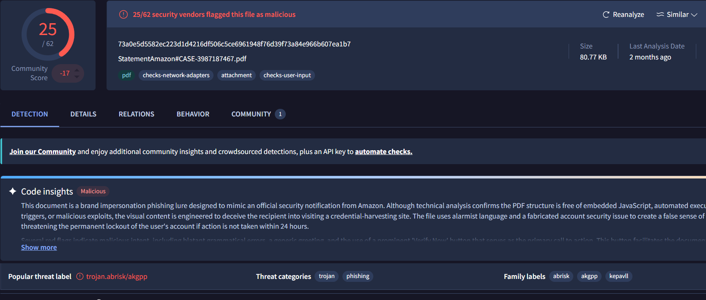
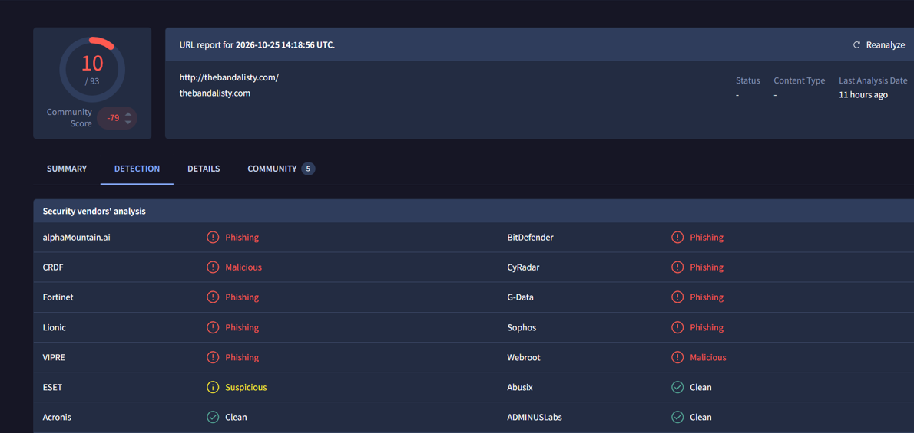

# Phishing Investigation & Email Triage Lab

A hands-on SOC Analyst L1 project: triaging 20 phishing and suspicious emails end to end, from header parsing and IOC enrichment to verdicts, incident reports, MITRE mapping, and draft detection rules.

> Raw `.eml` samples are kept local and gitignored. This repo contains the tooling, outputs, reports, and documentation.

## Results at a glance

| Metric | Value |
|---|---|
| Samples triaged | 20 (S01-S20) |
| Malicious | 3 (S01, S02, S17) |
| Suspicious | 16 |
| Benign / Spam | 1 (S09) |
| Full incident reports | 5 (S01, S02, S04, S11, S17) |
| Detection rules authored | 3 (2 KQL, 1 SPL) |

## Screenshots

**Triage script run and parsed auth results**


**One-line verdicts (`output/verdicts.csv`)**


**Incident report: S01 header analysis and IOCs**


**VirusTotal: S02 attachment hash, 25/62**


**VirusTotal: S01 URL/domain, 10/93**


## Workflow

1. **Intake:** index samples (`output/sample_index.csv`).
2. **Parse:** `scripts/triage.py` extracts SPF/DKIM/DMARC results, header mismatches, relay hops, public IP candidates, defanged URLs, and attachment SHA-256 hashes (`output/parsed_results.csv`).
3. **Enrich:** IOCs checked against VirusTotal and AbuseIPDB (`output/enrichment.csv`).
4. **Verdict:** `output/verdicts.csv` holds one-line verdicts for the 15 samples without a full report. The other 5 (S01, S02, S04, S11, S17) have full reports in `reports/`. Decisions follow `playbook/triage-playbook.md`.
5. **Report:** full write-ups using `reports/TEMPLATE.md`.
6. **Map and detect:** MITRE ATT&CK mapping and draft detection rules.

## Highlighted cases

| Sample | Verdict | Key findings |
|---|---|---|
| **S01** | Malicious | Microsoft impersonation; URL/domain `thebandalisty.com` flagged 10/93 on VirusTotal; no SPF/DKIM, DMARC permerror; sending IP 0% on AbuseIPDB (Poland hosting) |
| **S02** | Malicious | Amazon-impersonation PDF attachment; hash flagged 25/62 on VirusTotal |
| **S17** | Malicious | Userinfo-trick URL (hotmail name before `@`) hiding the real host; `run.app` host flagged 13/93 on VirusTotal; sending IP 0% on AbuseIPDB (Linode) |
| **S04** | Suspicious | `.docx` not found on VirusTotal; 2 extensionless attachments with 0-byte (stripped) payloads |
| **S11** | Suspicious | PDF not found on VirusTotal; sent from a real Gmail account with SPF/DKIM/DMARC all passing |

**Takeaway:** S11 shows that passing authentication does not mean safe, and S01/S17 show that a 0% IP reputation does not mean benign. Verdicts rest on combined evidence, not a single signal.

## MITRE ATT&CK mapping

See [`docs/mitre-mapping.md`](docs/mitre-mapping.md): T1566.001 (Spearphishing Attachment), T1566.002 (Spearphishing Link), T1036 (Masquerading).

## Detection rules

| File | Platform | Logic |
|---|---|---|
| `01-auth-fail-with-url.kql` | Microsoft Defender for Office 365 advanced hunting (KQL) | Inbound mail in the last day where SPF and DKIM both fail and the message contains a URL (`EmailEvents` joined to `EmailUrlInfo`). Motivated by S10, S15, S16, S19, S20 |
| `02-extensionless-attachment.kql` | Microsoft Defender for Office 365 advanced hunting (KQL) | Attachments in the last day whose file name is non-empty but contains no `.` (`EmailAttachmentInfo`) |
| `03-userinfo-trick-url.spl` | Splunk (SPL) | URLs in email or proxy logs with a `user@host` userinfo section; extracts `userinfo` and `real_host`. Motivated by S17 |

**Status: authored but not validated against live Defender, Sentinel, or Splunk data.**

## Repo structure

```
playbook/      Triage playbook
scripts/       triage.py parser
output/        CSV outputs (index, parsed results, enrichment, verdicts)
reports/       Report template + 5 full incident reports
detections/    KQL / SPL rules
docs/          MITRE mapping, screenshots
samples/       .eml files (gitignored, local only)
```

## Usage

```bash
python3 scripts/triage.py [samples_dir]
```

Expects files named `S*.eml` (default folder: `samples/`) and writes `output/parsed_results.csv`. Raw samples are not included in this repo; supply your own. If no matching files are found, the script exits with a message and leaves existing output untouched. It uses only the Python standard library.

## Known limitations

- **S04 payloads were stripped** (0-byte attachments), so no payload analysis was possible.
- **URLs for 15 samples were not looked up** in threat-intel tools; enrichment covers only the highlighted cases.
- **No URLScan scan was run.**
- **The IP regex can match version numbers**, producing false-positive IP candidates.
- **The Return-Path mismatch check gives false positives on subdomains** (seen in S05).
- **Detection rules were not run on live data;** they are authored but unvalidated.

## Skills demonstrated

Email header analysis, SPF/DKIM/DMARC interpretation, IOC extraction and defanging, VirusTotal and AbuseIPDB enrichment, Python scripting, MITRE ATT&CK mapping, KQL/SPL detection drafting, incident documentation.
